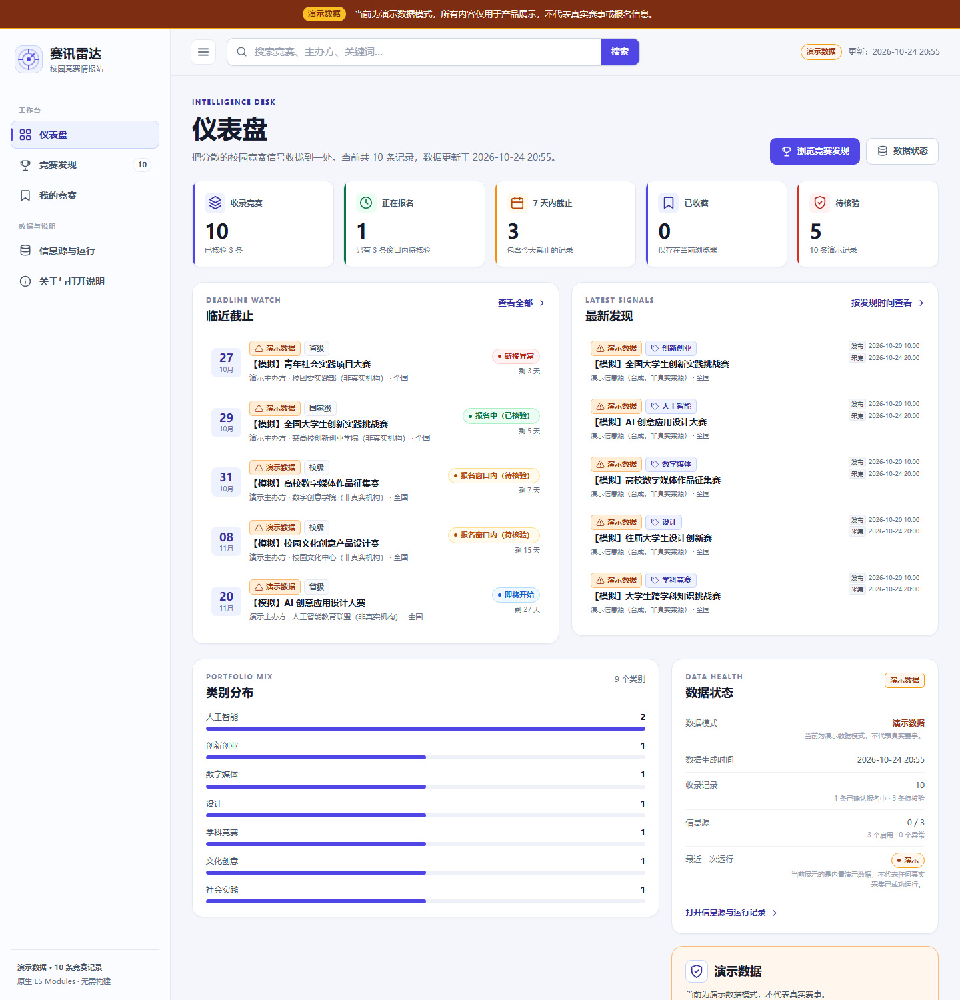
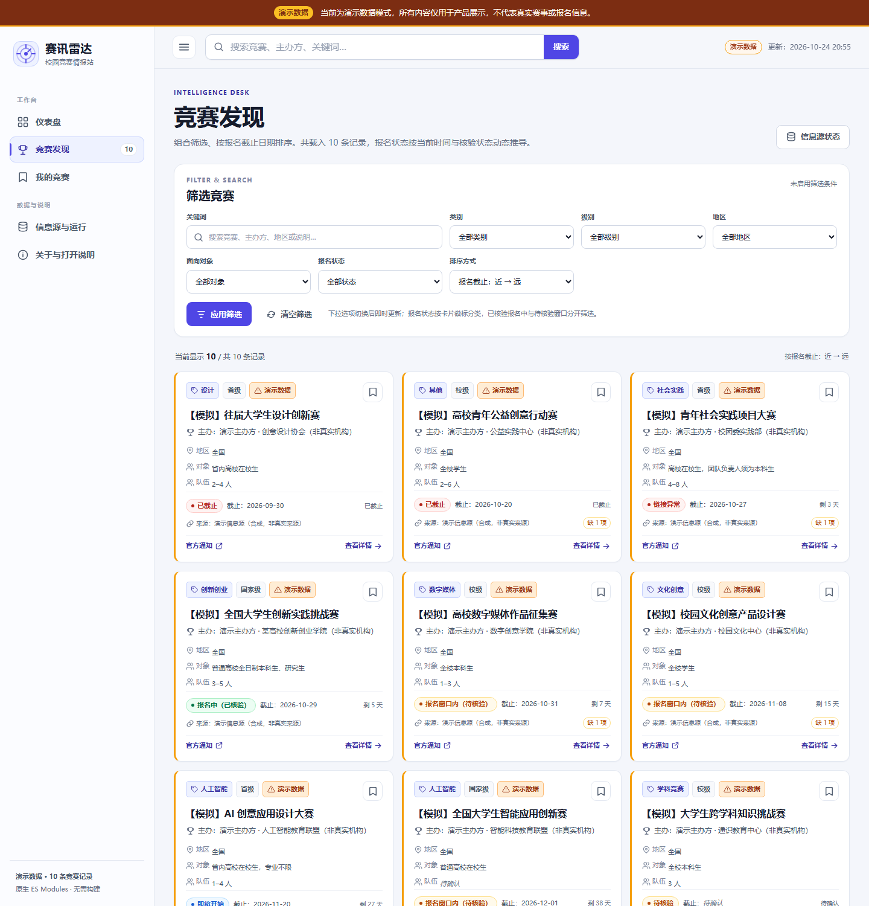
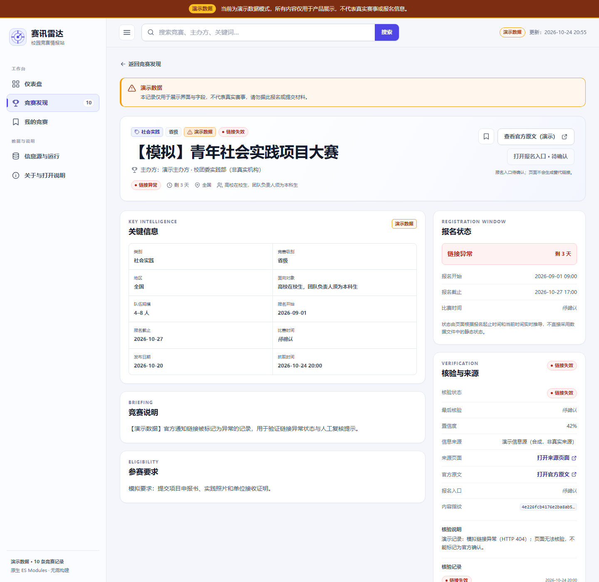

# 赛讯雷达 Campus Competition Radar

一个面向大学生的免费、可部署竞赛信息情报平台：自动采集公开竞赛通知，统一字段与数据质量检查，在静态站点中提供仪表盘、组合筛选、竞赛详情、报名截止提醒、收藏与报名进度管理、信息源运行记录和来源核验信息。

> **当前交付状态**：项目代码、测试和 GitHub Actions/Pages 配置已经完成，静态站点已通过 GitHub Pages 部署成功：<https://caosili114514.github.io/campus-competition-radar/>。首次 `Update competition data` 工作流已成功运行，线上数据已切换为 **`data_mode: live` 的 5 条公开采集记录**，全部仍为 `verification_status: pending`，不是官方确认信息。六个公开候选来源均已启用，但没有任何来源或记录被标记为已验证。



| 竞赛发现 | 竞赛详情 |
| --- | --- |
|  |  |

移动端与信息源运行页截图分别位于 `docs/screenshots/mobile-dashboard.png` 和 `docs/screenshots/sources.png`。截图拍摄于演示数据阶段，并已明确显示演示横幅；当前线上数据已切换为待核验的公开采集记录。

## 1. 已实现功能

### 前端

- 首页仪表盘：收录总数、已核验报名中、7 天内截止、已收藏、待核验，以及最新发现、临近截止、类别分布、最近运行与采集状态；所有统计由实际载入记录动态计算。
- 竞赛发现：关键词、类别、级别、地区、参赛对象和报名状态组合筛选；按截止日期或发布时间排序；一键清空；无结果友好提示。
- 报名状态准确性：仅已核验且在报名窗口内的记录显示"报名中"；未核验记录显示"报名窗口内（待核验）"；链接异常单独显示；截止后始终优先显示"已截止"。
- 竞赛详情：完整字段、资格、团队规模、作品要求、报名时间、官方原文与报名入口分开显示，缺失值显示"待确认"，并逐条渲染核验记录。
- 我的竞赛：收藏、准备中/已报名/已提交/已完成等进度、个人备注；状态保存在浏览器 `localStorage`，刷新后保留。
- 信息源与运行：展示来源名称、类型、检查/成功时间、结果、失败原因、记录数、需要人工核验的条目和运行历史。
- 视觉：浅色专业情报仪表盘、靛蓝强调色、固定侧栏、顶部搜索、响应式移动端、语义化 HTML 与键盘焦点态。使用原生 ES Modules，无构建步骤、无前端第三方依赖。
- 演示数据在整个站点显示固定横幅，每条记录显示"演示数据"徽标；数据加载失败时不会用假记录兜底。

### 采集与数据管线

- Python 标准库实现，无付费 API、无 AI 模型、无第三方运行依赖。
- 支持公开 HTML 列表、RSS、Atom、JSON Feed；来源有独立 URL/标题过滤、条数上限、请求间隔和更新频率。
- 顺序抓取详情正文，提取标题、发布时间、正文、官方原文链接和可识别字段；未知字段保持 `null`。
- 官方通知与报名入口分开保存，绝不自动拼接或猜测报名链接。
- 去重：canonical URL、标题与主办方相似度、sha256 内容哈希；同一公告更新时保留历史并重新进入待核验。
- 单来源和单详情失败隔离；已有 live 历史保留。
- robots.txt 检查、超时、有限重试、低频率顺序请求、明确 User-Agent；不绕过登录、验证码、403 或反爬限制。
- 链接事实核验区分 200、重定向、超时、403、404、连接错误、服务器错误和疑似 JavaScript 页面；HTTP 200 不被解释为报名开放。
- 生成 `competitions.json`、`sources.json`、`meta.json`、`quality-report.json` 和 JSONL 运行日志，并输出中文数据质量提示。
- 手动微信公众号公开链接入口；无法合法读取时写入 `manual-pending.json`，成功抓取也只保持 `pending`，不冒充官方确认。

### 测试与自动化

- Node 内置测试覆盖日期边界、报名状态、搜索/组合筛选、筛选与卡片状态一致性、localStorage 收藏/进度/备注持久化和字段归一化。
- Python unittest 覆盖数据结构、日期解析、去重、缺失字段、链接核验、来源失败容错、详情抓取隔离、robots.txt、调度、报名截止状态、微信公众号合规路径和发布演示数据检查。
- GitHub Actions：每日 UTC 定时与手动触发、Python/Node 测试、staging 采集、数据契约校验、安全发布保护、仅变化时普通 push。
- GitHub Pages：Actions artifact 部署、`.nojekyll`、子路径兼容、`workflow_run` 自动部署链路。
- 数据契约校验检查必需字段、ISO 时区、枚举、hash、重复 ID/标题/来源 URL、顶层计数和 JSONL。

## 2. 本地运行

前置环境：Python 3.10+（推荐 3.12），Node.js 18+ 仅用于运行前端测试。无需 `pip install` 或 `npm install`。

```powershell
# 1. 运行 Python 测试
python -m unittest discover -s tests/python -v

# 2. 运行前端测试
npm test

# 3. 校验已发布 JSON
python .github/scripts/validate_data.py --data-dir docs/data

# 4. 启动静态站点（必须通过 HTTP，不能直接双击 index.html）
python -m http.server 4173
```

打开 <http://localhost:4173>。页面全部使用 hash 路由，不需要服务器 rewrite。

## 3. 数据模式与真实来源状态

### 已发布数据

`docs/data/competitions.json` 当前是 `data_mode: live` 的 5 条自动采集记录，来源于中国大学生计算机设计大赛、全国大学生电子设计竞赛和全国大学生广告艺术大赛的公开通知。所有记录均为 `verification_status: pending`，报名截止和报名入口等未确认字段保持 `null`，不能视为官方确认或报名开放。原先的 10 条合成演示数据仍可通过 `tools/generate_demo_data.py` 和 `tests/fixtures/` 复现，只用于测试与界面演示。

### 信息源

`collector/sources.json` 配置了六个真实候选官方来源，当前维护者已将它们全部设为 **`enabled: true`、`verified: false`**：中国大学生计算机设计大赛、全国大学生信息安全竞赛、全国大学生电子设计竞赛、全国大学生数学建模竞赛、全国大学生广告艺术大赛、中国大学生服务外包创新创业大赛。启用表示允许低频采集，不表示来源或记录已核验。

开发期和首次线上采集结果见 [docs/SOURCES.md](docs/SOURCES.md)：六个列表页返回 HTTP 200，robots.txt 已检查；六个来源已启用，首次数据更新输出 5 条全部为 `pending` 的 live 记录并通过契约校验。来源和记录均未标记为已核验；抓取许可、逐条正文真实性、主办方授权和报名状态仍需维护者人工确认。

### 当前真实数据采集与安全扩量

1. 首次真实数据采集已经上线；如不希望访问某个来源，请把它改回 `enabled: false`。不要无依据设置 `verified: true`。
2. 如需新增来源，先阅读目标站点服务条款和 robots.txt，再添加独立配置并用低频测试；不要把未验证来源直接标记为已验证。
3. 本地复核可执行：

```powershell
Remove-Item -Recurse -Force collector-output -ErrorAction SilentlyContinue
python .github/scripts/seed_staging_data.py --target docs/data --stage collector-output
python -m collector --sources collector/sources.json --output collector-output
python .github/scripts/validate_data.py --data-dir collector-output
python .github/scripts/publish_staged_data.py --sources collector/sources.json --stage collector-output --target docs/data
python .github/scripts/validate_data.py --data-dir docs/data
```

没有启用任何来源、或 staging 为 0 条而当前仍为演示数据时，发布脚本会安全跳过；已有 live 数据时会保留历史和运行失败记录。首次 live 数据已生成，后续采集通过来源调度、过滤器和质量校验控制。

## 4. 采集器用法

```powershell
# 查看配置但不抓取、不写文件
python -m collector --sources collector/sources.json --output collector-output --dry-run

# 正常采集到临时/发布目录
python -m collector --sources collector/sources.json --output collector-output

# 已启用 manual 来源时，人工明确放行
python -m collector --sources collector/sources.json --output collector-output --force

# 手动提交公众号公开链接（输出 manual-pending.json 和待核验记录）
python -m collector.wechat --url "https://mp.weixin.qq.com/s/..." --output collector-output
```

常用参数：`--max-records`、`--max-link-checks`、`--timeout`、`--retries`、`--request-delay`、`--fixture`。采集器不会隐式写入 `docs/data/`，必须显式指定 `--output`。更多说明见 [collector/README.md](collector/README.md)。

## 5. 数据字段

每条记录必须始终包含契约字段，缺失值为 `null`，前端显示待确认。核心字段包括：

`id, title, organizer, category, competition_level, eligible_participants, team_size, registration_start, registration_deadline, event_start, event_end, description, requirements, official_notice_url, registration_url, source_name, source_url, published_at, fetched_at, last_verified_at, verification_status, registration_status, confidence, content_hash, region, is_demo, missing_fields, verification_notes`。

完整字段表、枚举、时区规则和状态推导见 [docs/DATA_SCHEMA.md](docs/DATA_SCHEMA.md)。官方通知与报名入口是分离字段；`registration_url` 不做自动拼接；全部时间使用带时区的 ISO 8601；演示数据与真实数据不能混用。

## 6. 测试范围

| 测试目标 | 位置 |
| --- | --- |
| 数据结构与缺失字段 | `tests/python/test_dates_schema.py`、`.github/scripts/validate_data.py` |
| 日期解析与截止状态 | `tests/python/test_dates_schema.py`、`tests/web/dates.test.js` |
| 去重与内容更新 | `tests/python/test_dedupe.py` |
| 链接核验状态 | `tests/python/test_link_checker.py`、`tests/python/test_run_links.py` |
| 搜索与多条件筛选 | `tests/web/filters.test.js` |
| 收藏与个人状态持久化 | `tests/web/storage.test.js` |
| 来源失败容错与详情隔离 | `tests/python/test_run_collection.py` |
| 调度与请求频率 | `tests/python/test_run_schedule.py` |
| 微信公众号合规处理 | `tests/python/test_wechat.py` |
| 演示数据标记、候选来源策略、抽取防误判 | `tests/python/test_lead_integration.py` |

边界测试数据位于 `tests/fixtures/competitions.edge-cases.json`，明确为模拟数据，覆盖重复公告等场景，不会进入生产 JSON。实际执行结果与浏览器验收记录见 [docs/VALIDATION.md](docs/VALIDATION.md)。

## 7. 部署

详细网页操作见 [docs/DEPLOYMENT.md](docs/DEPLOYMENT.md)。最少手动步骤：

1. 将完整项目上传/推送到 GitHub 仓库 `main` 分支。
2. `Settings -> Actions -> General`：启用 Actions，Workflow permissions 设为 Read and write。
3. `Settings -> Pages -> Build and deployment -> Source`：选择 **GitHub Actions**。
4. 打开 `Actions -> Update competition data -> Run workflow`，需要立即重新采集时勾选 `force`。如果筛选后没有有效记录，发布保护会保留现有数据。
5. 运行 `Actions -> Deploy static site to GitHub Pages -> Run workflow`，或在更新工作流成功后等待 `workflow_run` 自动部署。
6. 打开 Pages 环境给出的地址，项目站点通常为 `https://<owner>.github.io/<repo>/`。

GitHub Actions 的 cron 使用 UTC，当前为每天 UTC 18:17（北京时间次日 02:17）。计划任务可能延迟甚至跳过，不保证准点；需要立即更新时使用手动触发。Pages 部署与首次数据更新工作流均已实际运行成功，线上地址见文首。

免费额度、平台限制、纯静态架构边界和需要后端才能实现的能力见 [docs/KNOWN_LIMITATIONS.md](docs/KNOWN_LIMITATIONS.md)。

## 8. 项目结构

```text
.
├─ index.html                     # 静态应用入口
├─ assets/                        # CSS、原生 ES Modules、图标、分享图
├─ docs/
│  ├─ data/                       # 前端读取的 JSON 与质量报告
│  ├─ screenshots/                # 实际 Headless Edge 渲染截图
│  ├─ DATA_SCHEMA.md
│  ├─ SOURCES.md
│  ├─ DEPLOYMENT.md
│  └─ KNOWN_LIMITATIONS.md
├─ collector/                     # Python 采集、解析、核验、质量报告、公众号入口
├─ tests/
│  ├─ python/                     # 标准库 unittest
│  ├─ web/                        # Node 内置测试
│  └─ fixtures/                   # 明确标注的模拟边界数据
├─ tools/                         # 演示数据生成器与独立数据校验器
├─ .github/workflows/             # 每日更新与 Pages 部署
└─ package.json                   # 无依赖测试脚本
```

## 9. 安全、隐私与已知边界

- 没有真正的账号、登录、跨设备同步或服务端权限控制；收藏、进度和备注仅存当前浏览器 `localStorage`。
- 清除站点数据会丢失个人收藏和备注；不要把身份证号、手机号、报名凭证等敏感信息填入备注。
- 纯静态页面不能安全执行采集、代理或数据库操作。采集在本机或 GitHub Actions 中完成，再发布 JSON。
- 不批量抓取微信公众号，不绕过登录、验证码、访问限制或反爬机制。
- HTTP 可达不代表报名开放；主办方信息可能变化，报名、提交或缴费前必须查看官方原文。
- 任何真实来源启用前都必须人工确认许可、robots.txt、页面结构、请求频率和内容准确性。
- 如需多人登录、跨设备同步、后台管理权限和审计，需要单独建设后端与认证系统，当前静态站点不会伪装拥有这些能力。

## 10. 许可

代码以 [MIT License](LICENSE) 开源。采集到的第三方公告内容、主办方名称、商标和链接仍归原权利人所有，转载或公开使用前应遵守来源站点条款与版权要求。演示数据为项目合成内容。
